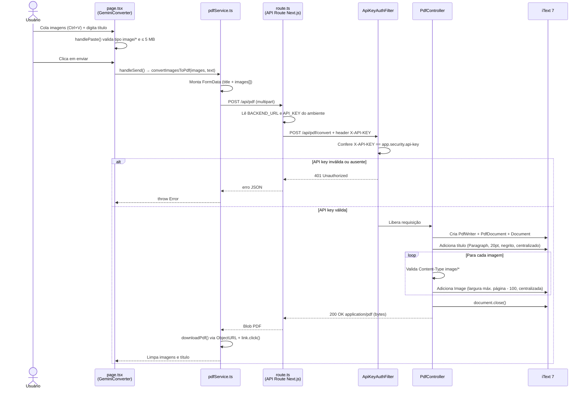

# 📋 Clipboard to PDF

Ferramenta para converter imagens coladas da área de transferência (clipboard) em um arquivo PDF, com um título opcional. O usuário cola as imagens na interface, digita um título e faz download do PDF gerado.

> **Arquitetura atual: síncrona, sem mensageria.** A comunicação entre frontend e backend é HTTP request-response direto. Não há RabbitMQ, fila, WebSocket, banco de dados ou microsserviços separados nesta versão (ver [O que não está implementado](#o-que-não-está-implementado)).

## Arquitetura

São dois serviços:

| Serviço | Tecnologia | Porta | Responsabilidade |
|---------|------------|-------|------------------|
| **Frontend** (`frontend/`) | Next.js 16 (App Router), React 19, TypeScript, Tailwind CSS 4 | `3000` | Interface: captura imagens coladas, envia para o backend e baixa o PDF |
| **Backend** (`demo/`) | Java 17+ (21 nos Dockerfiles), Spring Boot 3.4.3, Spring Security, iText 7.2.5 | `8080` | Recebe as imagens, valida a API key e gera o PDF em memória |

```mermaid
flowchart LR
    U[Usuário no navegador] --> FE[Frontend Next.js<br/>page.tsx + pdfService.ts]
    FE -->|POST /api/pdf<br/>multipart: title + images[]| API[API Route Next.js<br/>app/api/pdf/route.ts]
    API -->|POST /api/pdf/convert<br/>header X-API-KEY| BE[Backend Spring Boot<br/>PdfController]
    BE -->|PDF em memória<br/>ByteArrayOutputStream| BE
    BE -->|200 OK<br/>application/pdf| API
    API -->|200 OK<br/>application/pdf| FE
    FE -->|download no navegador| U
```

## Fluxo do Código

### Diagrama de sequência



### Passo a passo (com arquivos)

**1. Captura das imagens — `frontend/app/page.tsx`**
- O componente `GeminiConverter` (client component) escuta o evento `onPaste` na caixa de entrada (`handlePaste`).
- Cada item colado é aceito apenas se `type` contiver `image` e o tamanho for ≤ `5 MB` (`MAX_FILE_SIZE`); caso contrário mostra alerta.
- As imagens entram no estado `images` e aparecem como thumbnails, que podem ser removidas com o botão `×`.
- O botão de envio fica desabilitado enquanto `loading` ou sem `images` e sem `text` (`handleSend`).

**2. Envio pelo navegador — `frontend/services/pdfService.ts`**
- `convertImagesToPdf(images, text)` exige pelo menos 1 imagem (lança `Nenhuma imagem fornecida` caso contrário).
- Monta um `FormData` com o campo `title` (texto digitado) e um campo `images` por imagem.
- Faz `fetch` `POST /api/pdf` para a própria origem (sem expor a URL do backend no browser), aguarda a resposta, converte em `blob` e dispara o download (`downloadPdf`, via `URL.createObjectURL` + `<a download>` + `revokeObjectURL`).

**3. Proxy server-side — `frontend/app/api/pdf/route.ts`**
- A API Route `POST /api/pdf` lê o `FormData` recebido e repassa para o backend.
- URL do backend: variável `BACKEND_URL`, com padrão `http://localhost:8080/api/pdf/convert`.
- API key: variável `API_KEY`, com padrão `default-dev-secret-key-change-in-prod`, enviada como header `X-API-KEY`.
- Se o backend responder erro, devolve JSON com `error`/`details` e o mesmo status; se der certo, devolve o PDF com `Content-Type: application/pdf`. Erro de rede/servidor vira `500` com mensagem genérica.

**4. Segurança no backend — `demo/src/main/java/app/config/`**
- `ApiKeyAuthFilter` (um `OncePerRequestFilter`) compara o header `X-API-KEY` com `app.security.api-key`. Requisições `OPTIONS` (preflight de CORS) passam direto; as demais sem chave válida recebem `401 Unauthorized`.
- `WebSecurityConfig` desabilita CSRF, registra o filtro antes do `UsernamePasswordAuthenticationFilter`, libera `/api/**` (a API key continua sendo exigida pelo filtro) e configura CORS para `http://localhost:3000`, a URL do Railway e a variável `FRONTEND_URL`.

**5. Conversão para PDF — `demo/src/main/java/app/controller/PdfController.java`**
- Endpoint: `POST /api/pdf/convert`, recebendo `@RequestParam MultipartFile[] images` e `@RequestParam("title", required = false)`.
- Cria um `ByteArrayOutputStream` + `PdfWriter` + `PdfDocument` + `Document` (iText 7) — tudo em memória, sem salvar arquivo em disco.
- Se houver título, adiciona um `Paragraph` de 20pt, negrito e centralizado.
- Para cada imagem: rejeita com `400` se o `Content-Type` não for `image/*`; converte com `ImageDataFactory`, limita a largura a `página - 100`, centraliza e adiciona ao documento.
- Fecha o documento e devolve `200 OK` com o PDF em bytes, `Content-Type: application/pdf` e `Content-Disposition: attachment`.
- Qualquer exceção vira `500` com `Erro interno ao processar as imagens.` (e log via SLF4J).

**6. Configuração — `demo/src/main/resources/application.properties`**

| Propriedade | Variável de ambiente | Padrão |
|-------------|----------------------|--------|
| `server.port` | `PORT` | `8080` |
| `spring.servlet.multipart.max-file-size` | — | `5MB` |
| `spring.servlet.multipart.max-request-size` | — | `20MB` |
| `app.security.api-key` | `API_KEY` | `default-dev-secret-key-change-in-prod` |

### Erros possíveis

| Situação | Resultado |
|----------|-----------|
| Sem imagem (`pdfService.ts`) | `Error: Nenhuma imagem fornecida` (só título não gera PDF) |
| Arquivo > 5 MB no navegador | Alerta `Imagem muito grande` e imagem ignorada |
| `X-API-KEY` ausente/inválida | `401 Unauthorized` |
| Arquivo que não é imagem | `400 Erro: Apenas imagens são permitidas.` |
| Backend fora do ar ou erro interno | `500` (JSON no proxy, texto no backend) |

## Stack Técnica

- **Frontend:** Next.js 16 (App Router), React 19, TypeScript, Tailwind CSS 4, headers de segurança em `frontend/next.config.ts`
- **Backend:** Java 17+ (21 no Docker), Spring Boot 3.4.3, Spring Security, iText 7.2.5
- **Infra (opcional):** Docker & Docker Compose (`demo/Dockerfile`, `frontend/Dockerfile`, `docker-compose.yml`)

## Estrutura do Projeto

```
java-next/
├── docker-compose.yml          # Sobe backend (8080) + frontend (3000)
├── README.md
├── demo/                       # Backend Spring Boot
│   ├── Dockerfile              # Build multi-stage Maven 3.9 + Temurin 21
│   ├── pom.xml                 # web, security, iText
│   └── src/main/
│       ├── java/app/
│       │   ├── App.java                     # main: SpringApplication.run
│       │   ├── controller/PdfController.java
│       │   └── config/
│       │       ├── ApiKeyAuthFilter.java
│       │       └── WebSecurityConfig.java
│       └── resources/application.properties
└── frontend/                   # Frontend Next.js
    ├── Dockerfile              # Build multi-stage Node 20 Alpine
    ├── package.json            # dev / build / start / lint
    ├── app/
    │   ├── page.tsx            # Interface (colar imagens + título)
    │   ├── layout.tsx
    │   └── api/pdf/route.ts    # Proxy para o backend
    └── services/pdfService.ts  # Envio multipart + download do PDF
```

## Como Rodar

### Pré-requisitos

- **JDK 17 ou superior** (recomendado 21 — é o que os Dockerfiles usam; Spring Boot 3 não roda em Java 8)
- **Node.js 20+** e npm
- Opcional: Docker Desktop (apenas para o modo Docker)

### Opção A — Nativamente (modo recomendado)

Terminal 1 — Backend:

```bash
cd demo
# Windows (PowerShell):  .\mvnw.cmd -B package -DskipTests
# Linux/macOS:           ./mvnw -B package -DskipTests
java -jar target/pdf-converter-0.0.1-SNAPSHOT.jar
```

Terminal 2 — Frontend:

```bash
cd frontend
npm install
npm run dev          # ou: npm run build && npm start
```

Acesse **http://localhost:3000**, cole imagens com Ctrl+V, digite um título e clique em enviar. O PDF é baixado automaticamente.

### Opção B — Docker Compose

```bash
docker compose up --build
```

Sobe o backend em `http://localhost:8080` e o frontend em `http://localhost:3000`.

> **Atenção:** dentro da rede do Compose, o proxy do frontend precisa enxergar o backend pelo nome do serviço. A API Route usa a variável `BACKEND_URL` (não `NEXT_PUBLIC_API_URL`, que o `docker-compose.yml` atual define). Se o frontend não conseguir alcançar o backend com Docker, defina no serviço `frontend`: `BACKEND_URL=http://backend:8080/api/pdf/convert` e a mesma `API_KEY` do backend.

### Variáveis de Ambiente

| Serviço | Variável | Finalidade | Padrão |
|---------|----------|------------|--------|
| Backend | `PORT` | Porta do servidor | `8080` |
| Backend | `API_KEY` | Chave exigida no header `X-API-KEY` | `default-dev-secret-key-change-in-prod` |
| Backend | `FRONTEND_URL` | Origem CORS adicional | `http://localhost:3000` |
| Frontend | `BACKEND_URL` | URL completa do endpoint de conversão | `http://localhost:8080/api/pdf/convert` |
| Frontend | `API_KEY` | Deve ser igual à do backend | `default-dev-secret-key-change-in-prod` |

> ⚠️ A chave padrão é apenas para desenvolvimento. Em produção, defina `API_KEY` nos dois serviços e nunca versione a chave real no Git.

### Testar sem a Interface (curl)

```bash
curl -X POST http://localhost:8080/api/pdf/convert \
  -H "X-API-KEY: default-dev-secret-key-change-in-prod" \
  -F "title=Meu documento" \
  -F "images=@foto.png;type=image/png" \
  --output documento.pdf
```

Sem o header `X-API-KEY` o backend responde `401`; com a chave, `200` e o arquivo `documento.pdf`.

## O que Não Está Implementado

Para evitar confusão com versões anteriores deste README, o seguinte **não existe** nesta versão:

- ❌ Mensageria / fila (RabbitMQ, Kafka, Spring Cloud Stream) — nenhuma dependência ou código de consumidor/produtor
- ❌ WebSocket / notificação assíncrona — a resposta é síncrona, na mesma requisição
- ❌ Microsserviços separados (Image Service / PDF Worker) — é um único backend
- ❌ Banco de dados, S3 ou persistência — o PDF é gerado em memória e devolvido direto
- ❌ Autenticação de usuários (Keycloak/OAuth) — só API key por header

## Roadmap / Próximos Passos

- [ ] Mensageria assíncrona (RabbitMQ) + separação em Image Service e PDF Worker
- [ ] WebSocket para notificar o frontend quando o PDF estiver pronto
- [ ] Persistência em AWS S3
- [ ] Autenticação via Keycloak ou Spring Security com usuários
- [ ] Monitoramento de filas (RabbitMQ Management)

## Troubleshooting

- **`UnsupportedClassVersionError` / erro de Java:** você está com Java 8. Instale JDK 17+ e aponte `JAVA_HOME` para ele antes de rodar o Maven/`java`.
- **Erro de build no Next.js em `.next/dev/types/routes.d.ts`:** cache corrompido. Apague a pasta e tente de novo:
  - PowerShell: `Remove-Item -Recurse -Force .next; npm run build`
  - Linux/macOS: `rm -rf .next && npm run build`
- **`401` em tudo:** confira se `API_KEY` do frontend é igual à do backend (`app.security.api-key`).
- **Porta em uso:** altere `PORT` (backend) ou rode com outra porta no frontend (`npm start -- --port 3001`).
